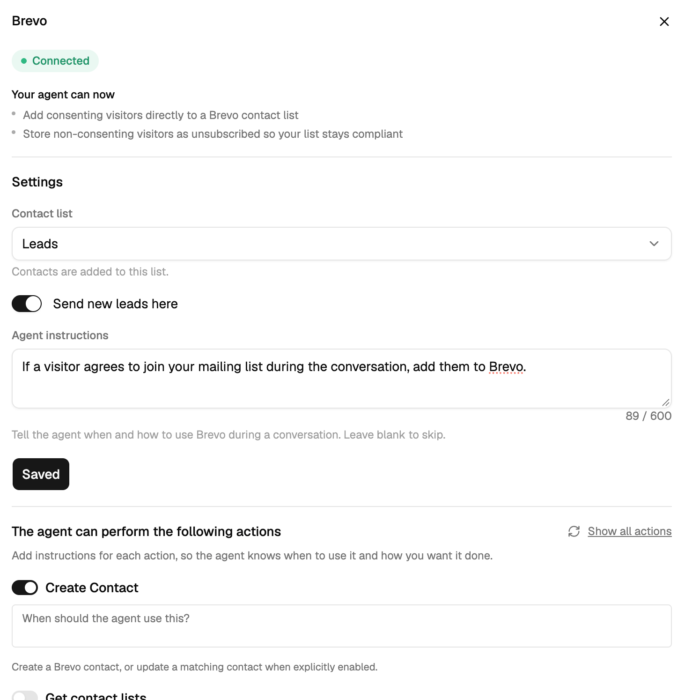
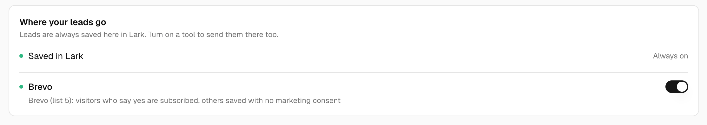

Available on Starter and above.

## Connect

1. Open **Integrations** and click on Brevo tile. It will ask for an API key.
2. Go to Brevo API keys ([https://app.brevo.com/settings/keys/api](https://app.brevo.com/settings/keys/api)) and generate a new API key
3. Come back to Lark, Enter your Brevo API key and click **Connect**
4. Once connected, click Save settings. Also select the list where you would like to send the leads. The lists from your Brevo account will automatically appear in dropdown once you have established the connection.

<Frame>
  
</Frame>

## Who gets added

Only visitors who agreed to receive emails when the agent asked. Their consent wording, answer and time are recorded with the lead. In **Leads** page in your Lark dashboard, you can select one or multiple destinations to send these leads to. By default all contacts are saved in Lark dashboard > Leads

<Frame>
  
</Frame>
